  
    
  An independent studio mixing design, tech, and a little bit of the unexpected, to make things that stand out.
    
  <a href="https://www.lesgo.works/">Website</a> &nbsp;·&nbsp;
  <a href="https://cal.com/lesgohq">Book a call</a> &nbsp;·&nbsp;
  <a href="mailto:hello@lesgo.works">Email</a> &nbsp;·&nbsp;
  <a href="https://www.linkedin.com/company/lesgohq">LinkedIn</a> &nbsp;·&nbsp;
  <a href="https://www.instagram.com/lesgohq">Instagram</a> &nbsp;·&nbsp;
  <a href="https://x.com/lesgohq">X</a>

 

## 00. Manifesto

Got a crazy little idea? We turn early ideas into distinctive brands, websites, apps and AI workflows. Built for founders and teams ready to make their next move.

`strategy` &nbsp;·&nbsp; `design` &nbsp;·&nbsp; `development` &nbsp;·&nbsp; `motion`

---

## 01. What we do

| No. | Discipline | What it means |
| :--- | :--- | :--- |
| **01** | **Branding and Design** | Identity systems and interfaces with a point of view |
| **02** | **Web and App Development** | Fast, scalable sites and products, shipped properly |
| **03** | **AI and Automation** | Custom AI workflows that remove the boring parts |
| **04** | **Business Systems** | Internal tools, dashboards and integrations |
| **05** | **3D Development** | Interactive 3D experiences, built to run anywhere |
| **06** | **Content Production** | Motion and visuals that carry a launch |
| **07** | **Digital Marketing** | Positioning and campaigns that get seen |

---

## 02. How we work

  

Clear timelines. No surprise invoices. Tech choices explained in plain language.

---

## 03. Selected work

| Project | In one line |
| :--- | :--- |
| [**Crunch3D**](https://www.lesgo.works/work/crunch3d) | Shrinking heavy 3D meshes without losing what matters |
| [**Manch**](https://www.lesgo.works/work/manch) | One platform to run events and hackathons end to end |

---

## 04. The people

<table>
  <tr>
    <td align="center" width="170">
      
       
      <b>Sourav Kumar</b>
       
      @itzsouravkumar
    </td>
    <td align="center" width="170">
      
       
      <b>Anish Mall</b>
       
      @anish-9387
    </td>
    <td align="center" width="170">
      
       
      <b>Ayush</b>
       
      @itzayush18
    </td>
    <td align="center" width="170">
      
       
      <b>Aashi Soni</b>
       
      @aashisoni000
    </td>
  </tr>
</table>

---

## 05. Tools of the trade

### Languages

### Frontend

### Backend

### Mobile

### Databases

### AI and Automation

### DevOps and Infra

### Design and 3D

 

---

  LESGO 
  creative technology and digital design / independent studio / © 2026 LESGO Studios

